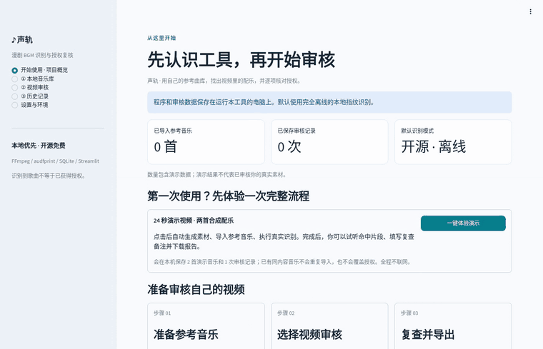

# 声轨 (Shēngguǐ) · local-bgm-auditor

[](https://github.com/ziwenqingshu/local-bgm-auditor/actions/workflows/ci.yml)
[](LICENSE)
[](https://www.python.org/downloads/)

**Find the background music in short-drama videos, fully offline, by fingerprinting against your own reference library, then check every hit against your licence records.**

[中文说明（完整文档）](README.md) · [Changelog](CHANGELOG.md) · [Contributing](CONTRIBUTING.md) · [Security](SECURITY.md)



The app's interface is in Simplified Chinese. It is a local Streamlit app that:

- extracts the first audio track with **FFmpeg** and aligns it to the video's timeline (it pads delayed audio and trims audio that starts early),
- matches sliding windows against your reference tracks with the original **[audfprint](https://github.com/dpwe/audfprint)** algorithm (vendored, unmodified, MIT),
- merges adjacent hits, applies conservative licence rules, and stores everything (evidence windows, aligned-hash counts, licence snapshots, manual review log) in **SQLite**,
- exports CSV (formula-injection safe) and JSON reports.

The default flow is **free, open source and offline**: no API keys, GPU, cloud, Docker or Redis, and it listens on `127.0.0.1` only. An optional, off-by-default ShazamIO integration exists for people who accept sending audio features to a third-party service.

> [!IMPORTANT]
> It only recognises music **you have imported**. No commercial fingerprint database is included. Results are an aid for checking licence records. They are **not** a licence and **not** legal advice.

## Quick start

Requires Python 3.12 and FFmpeg (with ffprobe). The scripts use [uv](https://docs.astral.sh/uv/) when it is available.

```bash
git clone https://github.com/ziwenqingshu/local-bgm-auditor.git && cd local-bgm-auditor
./install.sh && ./start.sh          # Windows: install.bat, then start.bat
# open http://127.0.0.1:8501 and click 「一键体验演示」 (one-click demo)
```

The demo synthesises two original tracks and a 24-second video. Expected result: track 「星河」 at 2–12 s and 「远山」 at 12–22 s. Both show as 「待核验」 (pending verification) because no licence has been recorded.

## Licence rules

| Situation | Status |
| --- | --- |
| Hit, no qualifying licence record | 待核验 (pending) |
| Local hit, licence registered, manually verified, evidence given, and the current purpose is covered | 授权已核验 (verified) |
| Licence explicitly does not cover this use | 不通过 (rejected) |
| Scan succeeded, nothing matched | 未检出，仍需复核 (none found, still review) |
| Any engine error, empty library, or audio failure | 识别不完整 (incomplete) |
| Different engines report different songs in overlapping ranges | 人工复审 (manual review) |

Task priority: rejected > manual review > incomplete > none found > all verified > pending.

## Development

```bash
./install.sh --dev
.venv/bin/python -m pytest -q --cov=bgm_audit
.venv/bin/ruff check . && .venv/bin/ruff format --check . && .venv/bin/mypy
```

CI runs the full suite on Ubuntu, macOS and Windows (Python 3.12, real FFmpeg and audfprint, Shazam mocked), plus ruff, mypy and a gitleaks scan of the full history.

## Limitations

The app only matches imported references. Dialogue, heavy mixing, tempo or pitch changes and very short excerpts reduce accuracy, and time ranges are estimates. Only the first audio track is audited. Accuracy has only been measured on synthetic audio. The one-click install scripts have been verified on Linux only. The app is built for a single local user and should not be exposed to a network.

## Legal

This is a tool for checking licence records. It does not give legal advice. "None found" does not mean the video is free of copyrighted music. You supply the reference music and licence materials and are responsible for them. All audio in this repository is synthesised by `bgm_audit/demo.py`.

## License

MIT, see [LICENSE](LICENSE). The vendored audfprint is MIT (© Dan Ellis, Columbia University, and Google). See [THIRD_PARTY_NOTICES.md](THIRD_PARTY_NOTICES.md).
