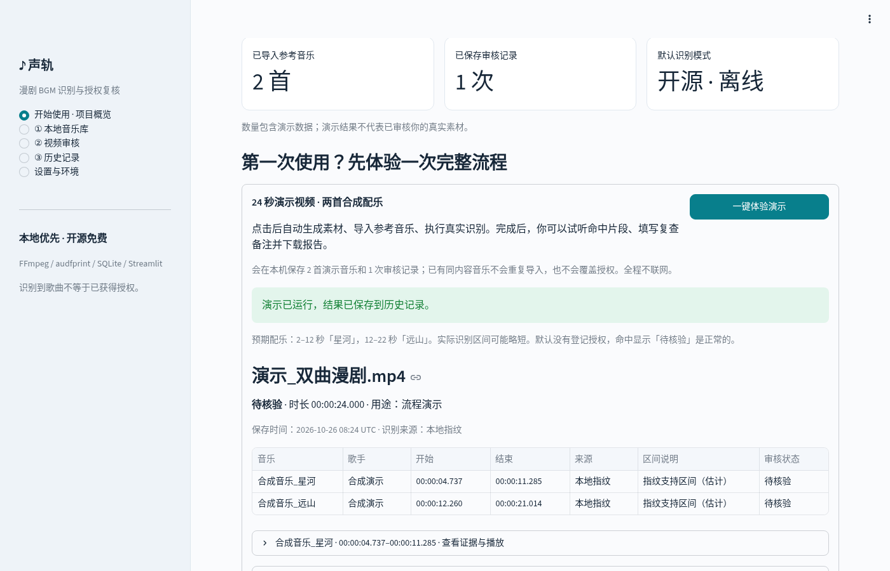
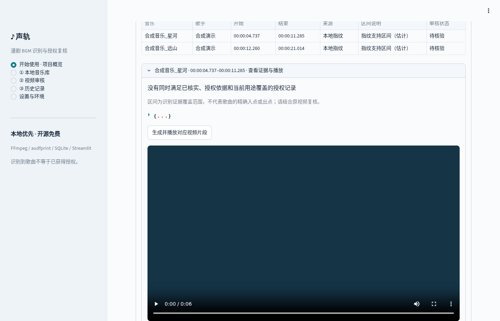
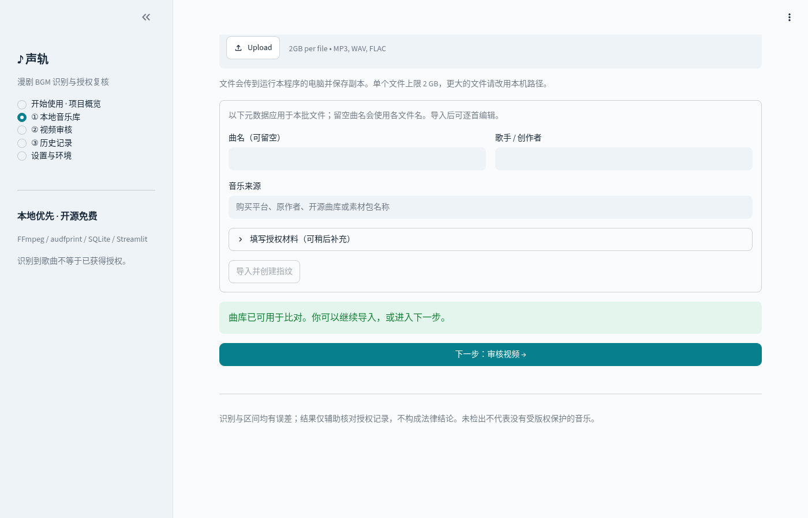
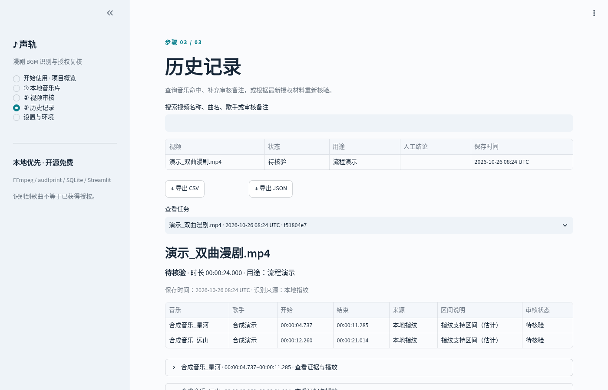
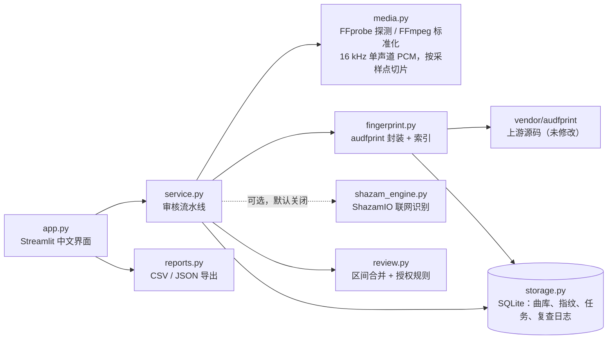

# 声轨 · local-bgm-auditor

[](https://github.com/ziwenqingshu/local-bgm-auditor/actions/workflows/ci.yml)
[](LICENSE)
[](https://www.python.org/downloads/)
[](.github/workflows/ci.yml)

**用你自己的参考曲库，完全离线地找出短剧 / 漫剧视频里的背景音乐，并按授权记录逐条复核。**

[English](README.en.md) · [更新日志](CHANGELOG.md) · [参与贡献](CONTRIBUTING.md) · [安全策略](SECURITY.md) · [第三方说明](THIRD_PARTY_NOTICES.md)


声轨是一个本地运行的 Streamlit 应用：用 FFmpeg 提取音轨，用 [audfprint](https://github.com/dpwe/audfprint) 与你导入的参考音乐做声纹比对，标出每首歌在视频中出现的时间段，再把命中结果和你登记的授权材料对照，给出「待核验 / 授权已核验 / 不通过 / 人工复审」等状态。所有数据保存在本机 SQLite，支持人工复查、历史检索和 CSV / JSON 导出。

- **默认全离线、免费、开源**：不需要 API Key、GPU、云服务、Docker 或 Redis；Streamlit 只监听 `127.0.0.1`，使用统计已关闭。
- **证据可追溯**：每个命中保存原始切片窗口、对齐指纹数量和参考曲偏移，以及审核当时的授权快照。
- **规则保守**：只有「已登记 + 已人工核实 + 有授权依据 + 明确覆盖当前用途」同时满足才算「授权已核验」；未检出 ≠ 没有版权风险。

> [!IMPORTANT]
> 本地识别只能命中你**已导入**的参考音乐，项目不附带任何商业音乐指纹库。识别结果和时间区间仅用于辅助核对授权记录，**不能代替音乐授权，也不构成法律意见**。

## 目录

- [快速开始](#快速开始)
- [功能截图](#功能截图)
- [使用流程](#使用流程)
- [架构概览](#架构概览)
- [审核规则](#审核规则)
- [识别与时间轴](#识别与时间轴)
- [数据与备份](#数据与备份)
- [测试](#测试)
- [可选：ShazamIO 联网识别](#可选shazamio-联网识别)
- [可选：Docker](#可选docker)
- [已知限制](#已知限制)
- [法律声明](#法律声明)
- [许可证](#许可证)

## 快速开始

需要 **Python 3.12** 和 **FFmpeg（含 ffprobe）**。安装脚本会优先使用 [uv](https://docs.astral.sh/uv/) 自动准备 Python 3.12，并在缺少 FFmpeg 时尝试用系统包管理器安装。

**macOS / Linux**

```bash
git clone https://github.com/ziwenqingshu/local-bgm-auditor.git
cd local-bgm-auditor
./install.sh        # 创建 .venv 并安装依赖；可加 --dev 安装测试工具
./start.sh          # 打开 http://127.0.0.1:8501
```

**Windows**

```bat
git clone https://github.com/ziwenqingshu/local-bgm-auditor.git
cd local-bgm-auditor
install.bat
start.bat
```

<details>
<summary>安装脚本做了什么 / 手动安装</summary>

- 有 uv 时：`uv python install 3.12`，`uv venv .venv`，`uv pip install -r requirements.txt`。没有 uv 时使用 `python3.12 -m venv`（Linux 需要 venv 模块，如 Debian / Ubuntu 的 `python3.12-venv`）；Windows 使用 `py -3.12`，缺失时尝试 `winget install Python.Python.3.12`。
- 缺少 FFmpeg 时：macOS 使用 Homebrew；Linux 依次尝试 apt / dnf / pacman（可能需要管理员密码）；Windows 尝试 `winget install Gyan.FFmpeg`，装好后需重新打开终端以刷新 PATH。
- 手动安装也可以：只要 `ffmpeg` 和 `ffprobe` 在 PATH 中，然后：

  ```bash
  python3.12 -m venv .venv
  .venv/bin/python -m pip install -r requirements.txt
  .venv/bin/python -m streamlit run app.py --server.address 127.0.0.1
  ```

安装阶段需要联网下载依赖；安装完成后，本地指纹识别不发出任何网络请求。
</details>

启动后在首页点击 **「一键体验演示」**：程序会生成两首原创合成音乐和一段 24 秒的视频，执行真实的离线指纹识别。预期在 **2–12 秒命中「星河」、12–22 秒命中「远山」**（指纹支持区间通常比实际区间略短），由于没有登记授权，两首都显示「待核验」。

## 功能截图

| 首页与演示结果 | 片段预览 |
| --- | --- |
|  |  |
| **本地音乐库** | **历史记录** |
|  |  |

截图均来自真实运行的应用（Chromium 无头浏览器自动操作），素材由 `scripts/create_demo.py` 合成。

## 使用流程

1. **本地音乐库**：上传或填写 MP3 / WAV / FLAC 的本机路径。批量元数据会应用到每个文件，曲名留空时使用文件名。导入后可逐首编辑创作者、来源和授权材料，也可以替换参考音频并重新计算指纹。
2. **登记授权**：填写授权登记状态、授权依据（材料位置或许可链接）、是否已人工核实、覆盖的用途和备注（期限、地区、平台、改编条件等）。
3. **视频审核**：选择一个或多个 MP4 / MOV，保持默认的「本地指纹」离线模式，填写本次用途（如「漫剧商业发布」，须与授权记录中的用途完全一致），点击「开始批量审核」。
4. **复查**：查看命中表，展开每首音乐查看原始窗口、指纹数量、授权快照，生成并播放对应片段；填写备注和人工处理结论（与自动状态分开保存，复查日志不会被覆盖）。
5. **导出与追溯**：下载 CSV / JSON；在历史页按视频名、曲名、歌手、备注检索，或在更新授权材料后「重新核验」。

上传模式单个文件上限 2 GB，大文件请使用本机路径。审核时会保存原视频副本供复查；删除历史任务会同时删除该副本和预览，不会删除你的原始文件。

## 架构概览



| 模块 | 职责 |
| --- | --- |
| `app.py` | 五个页面（开始使用、音乐库、视频审核、历史、设置），文件锁串行化写操作 |
| `bgm_audit/service.py` | 复制视频 → 提取音轨 → 分窗口识别 → 合并 → 授权规则 → 保存；任何单段失败都记录为错误而不是「未检出」 |
| `bgm_audit/media.py` | FFprobe / FFmpeg 封装：音轨延迟补齐或裁剪、采样点精确切片、预览片段 |
| `bgm_audit/fingerprint.py` | 调用上游 audfprint 生成与匹配指纹；SQLite 为事实来源，`fingerprints.pklz` 索引可随时重建 |
| `bgm_audit/review.py` | 同引擎同曲相邻窗口合并、授权状态判定、任务汇总优先级 |
| `bgm_audit/storage.py` | SQLite（WAL）：曲库、指纹、任务、人工复查日志及快照 |
| `bgm_audit/reports.py` | CSV（含防公式注入）/ JSON 导出 |
| `bgm_audit/demo.py` | 固定随机种子合成演示音乐与视频 |

## 审核规则

| 情况 | 单曲状态 |
| --- | --- |
| 命中音乐，没有满足条件的授权材料 | 待核验 |
| 本地命中，材料已人工核实、有授权依据、明确覆盖当前用途 | 授权已核验 |
| 登记的授权明确不覆盖当前使用 | 不通过 |
| 成功扫描但没有命中 | 未检出，仍需复核（任务级） |
| 任意引擎异常、曲库为空或音轨处理失败 | 识别不完整（任务级），并记录具体错误 |
| 不同引擎在重叠区间识别出不同歌曲 | 人工复审（已「不通过」的命中保持不通过） |

任务汇总优先级：**不通过 > 人工复审 > 识别不完整 > 未检出 > 全部授权已核验 > 待核验**。无论汇总状态如何，全部错误都会保留和展示。用途比较会忽略首尾空白，其余必须完全一致。在线识别结果永远不会被判定为「授权已核验」。这张表由 `tests/test_rules.py` 逐行验证。

## 识别与时间轴

- FFprobe 读取时长和**第一个**音轨；FFmpeg 标准化为 16 kHz / 单声道 / PCM16 WAV，并以视频画面起点为 0：音轨晚开始时补静音，早开始时裁掉前段。无音轨会明确报错。
- 默认本地窗口 30 秒、步长 15 秒，启用 audfprint 的 `find_time_range` 和精确对齐计数；每个窗口允许返回多首歌，至少 15 个对齐指纹、至少 1 秒支持区间。参数可在「设置与环境」调整。
- 本地匹配区间是**指纹证据的时间支持范围**，通常比歌曲实际区间短，不是精确剪辑边界。原始窗口和参考曲偏移保存在报告里。
- 同引擎、同歌曲、相邻窗口且间隔不超过合并容差（默认 1.5 秒）的结果才合并；中间窗口未命中或失败时不跨越合并。
- 指纹索引常驻约 200 MiB 内存，建议至少 2 GB 可用内存，无需 GPU。曲库上限 4095 首，单首最长约 6 小时 45 分钟（超出会拒绝导入，避免时间字段溢出）。

## 数据与备份

默认数据目录是项目内的 `data/`（已被 `.gitignore` 排除），启动前可设置环境变量 `BGM_DATA_DIR` 指向其他本地目录。

```text
data/
  audit.sqlite3          曲库元数据、指纹、任务、切片证据、授权快照和人工复查日志
  fingerprints.pklz      audfprint 索引（可由 SQLite 重建）
  library/               导入的参考音乐副本
  videos/                审核视频副本
  previews/              片段预览缓存
  temp/                  处理期间的临时音频（完成后自动清理）
  settings.json          扫描设置
```

备份时先停止程序，再复制整个 `data/` 目录。数据库保存了本地副本的绝对路径，建议在相同路径恢复。程序只加载自己生成的指纹索引；**不要**用来源不明的 `fingerprints.pklz` 替换它（该格式基于 pickle）。Git 只管理代码，不会上传或备份你的曲库和视频。

## 测试

```bash
./install.sh --dev                       # 或：.venv/bin/python -m pip install -r requirements-dev.txt
.venv/bin/python -m pytest -q --cov=bgm_audit
.venv/bin/ruff check . && .venv/bin/ruff format --check . && .venv/bin/mypy
pre-commit install                       # 可选：提交前自动运行 ruff / mypy / gitleaks
```

Windows 把 `.venv/bin/python` 换成 `.venv\Scripts\python.exe`。

测试全部离线运行：用固定种子合成的原创音频驱动**真实的** FFmpeg + audfprint，Shazam 部分全部使用 Mock。覆盖建库与重复导入、同曲片段、多曲视频、单窗口多曲、两首歌叠加、音轨早于 / 晚于画面、多音轨、无音轨、空文件 / 损坏 / 截断文件、空曲库、合并规则、README 审核规则表、索引损坏恢复、CSV / JSON、历史检索、复查日志、设置校验，以及五个页面和一键演示流程（Streamlit AppTest）。

GitHub Actions 在 **Ubuntu、macOS、Windows**（Python 3.12）上运行全部测试，另有 ruff、mypy 和 gitleaks 全历史扫描；`bgm_audit/` 分支覆盖率约 97%，CI 低于 85% 即失败。

联网测试真实 Shazam 需要主动开启（安装可选依赖，并提供你有权识别的清晰音乐）：

```bash
BGM_LIVE_AUDIO="/path/to/song.mp3" .venv/bin/python -m pytest -q -m live
```

未设置 `BGM_LIVE_AUDIO` 时该测试会跳过。

单独生成演示素材（不会自动导入曲库）：

```bash
.venv/bin/python scripts/create_demo.py
```

## 可选：ShazamIO 联网识别

**默认未启用，也不在默认依赖中。** [ShazamIO 客户端](https://github.com/shazamio/ShazamIO)是开源的，但它调用的 Shazam 服务不是；启用后音频特征会发送给第三方。严格要求全流程开源 / 离线时，请只使用本地指纹模式。

```bash
./install.sh --with-shazam      # Windows：install.bat --with-shazam
```

在审核页手动勾选后，可选择「本地指纹 + Shazam」或「仅 Shazam」。默认 12 秒窗口 / 6 秒步长、至少 2 秒请求间隔、单次超时 25 秒、最多额外重试 2 次；失败分为网络、超时、429 限流、服务异常和接口变更。在线结果只标注**切片覆盖的估计区间**，保留 key、ISRC、链接和 Apple Music ID。该服务的可用性、接口和限流不由本项目控制。

## 可选：Docker

推荐方式仍是上面的本地安装。如果你更习惯容器：

```bash
docker build -t local-bgm-auditor .
docker run --rm -p 127.0.0.1:8501:8501 -v "$PWD/data:/data" local-bgm-auditor
```

容器内监听 `0.0.0.0`，请务必像上面这样只把端口映射到 `127.0.0.1`。数据保存在挂载的 `data/` 目录。镜像内的 FFmpeg 来自 Debian 软件源（GPL / LGPL），见[第三方说明](THIRD_PARTY_NOTICES.md)。

## 已知限制

- 只能识别曲库中已有的参考音乐；不能离线得知陌生歌曲的名称。
- 对白压过音乐、强混音、变速、变调和极短片段可能造成漏检或误检；时间区间是估计值。
- 多音轨视频只审核第一个音轨。
- 授权状态完全基于你登记和人工核实的材料，程序不会验证材料真伪或有效期。
- 识别准确率只在合成素材上验证过，不代表商业音乐上的实际识别率。
- 测试在 Linux / macOS / Windows 的 CI 上通过；`install.sh` / `install.bat` 一键安装脚本目前只在 Linux 实机验证过。
- 每次导入或删除参考音乐都会重建并写出完整索引（约 200 MiB），大批量导入时会比较慢。
- 应用面向单机个人使用：没有用户系统，不应暴露到局域网或公网。

## 法律声明

本软件只是辅助核对授权记录的技术工具。识别结果和时间区间都可能有误差；「未检出」不代表视频中没有受版权保护的音乐，「授权已核验」也仅表示命中音乐的登记材料经过了**你本人**的人工确认，不证明整段视频不存在其他未识别的音乐。本项目不提供法律意见，任何发布决定请以授权合同和专业法律意见为准。

参考音乐及其版权、授权材料由使用者自行提供并负责；本项目的软件许可证不授予任何音乐作品的使用权。仓库和演示中的所有音频均由 `bgm_audit/demo.py` 用固定随机种子合成，不包含任何第三方录音。

## 许可证

项目代码采用 [MIT 许可证](LICENSE)。随附的 [audfprint](vendor/audfprint/LICENSE) 为 MIT 许可证（© Dan Ellis, Columbia University, and Google），源码固定在上游提交 `cb03ba9` 且未经修改。其他依赖的许可证见 [THIRD_PARTY_NOTICES.md](THIRD_PARTY_NOTICES.md)。
